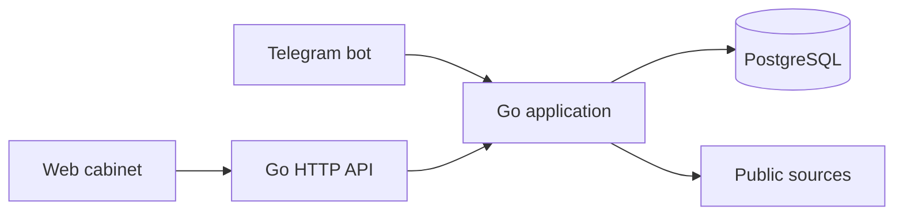

# CareerRadar

[Русская версия](README.md)

A work-in-progress personal IT opportunity tracker built with Go and PostgreSQL. CareerRadar collects public job information without LLMs and keeps unknown facts separate from confirmed ones.

> **Development preview:** the product does not yet meet the complete MVP specification. Review the limitations below before relying on it for real applications.

## Current functionality

- Add, confirm, disable, edit and remove monitored source URLs through the API; import `name,url` CSV files or the `company,start_url` columns of the `SOURCES` sheet without activating imported sources.
- Search Wikidata for candidate company websites and propose career links for confirmation. Search public Remotive listings with attribution.
- Read schema.org [`JobPosting`](https://schema.org/JobPosting) and [`EducationalOccupationalProgram`](https://schema.org/EducationalOccupationalProgram) JSON-LD and Microdata, including relative URLs; follow a bounded number of relevant same-host HTML links and pagination links, and use public Greenhouse and Ashby APIs plus [Lever's public XML postings feed](https://hire.lever.co/developer/usecases). JSON-LD takes precedence when a page publishes both formats to avoid duplicate observations. An individual HTML job page without structured data retains its title and application link only when its URL looks like a job and an `Apply` link is explicit; missing fields remain for clarification. Greenhouse provides location, deadline, title and description; Ashby publishes workplace, application and compensation details; Lever's XML feed provides employer, location, commitment, description and apply link. Missing or ambiguous information remains unknown.
- Preserve observed facts when a later observation is incomplete; retain source evidence and change snapshots, including previous terms, deadlines and descriptions in job details, and distinguish source errors from confirmed closure. A previously observed individual Greenhouse job closes only on a `404` from its exact public Job Board API endpoint. A Lever job closes only when it is missing from its public feed and its exact individual page returns an unredirected `404`; feed absence, redirects and access errors do not close it. If the same Greenhouse endpoint or Lever feed later publishes a job that it closed, the app reopens it; owner-confirmed closures remain unchanged. Jobicy uses its status API.
- Schedule enabled-source checks at 08:00 Europe/Moscow with up to two checks concurrently. Missed runs are not backfilled.
- Search the Russian web catalog by title or company and combine filters for level, direction, language, company, location, offer type and work mode, with multiple values per filter. Also view source health and check history, and change application status and preferences, including minimum and maximum monthly pay. Initial preferences include Go/Python, the listed IT directions, Russia/Kazan/Innopolis and a 30-hour weekly maximum. The current collector extracts only some fields used by filters.
- Link a private Telegram chat with an expiring one-use code. The bot supports `/jobs`, `/sources`, `/cabinet`, `/add`, `/confirm`, `/disable`, `/edit`, `/delete`, `/check`, `/status` and `/help`. `/cabinet` links to cabinet sections and `/jobs` links to job details when a public HTTPS `CABINET_URL` is configured. The `/jobs` list shows application, closure and clarification statuses; notifications describe known job terms and changes, including deadlines and compensation. Daily summaries include counts of new and changed jobs over the last 24 hours. Source warnings and summaries are queued in PostgreSQL. Uncertain delivery is not retried automatically.
- Serve an authenticated REST API, OpenAPI document and Swagger UI.

Offer categories are `Job`, `Internship`, `Trainee / Graduate Program` and `Education / Bootcamp`. Job postings are categorized as `Job`; internships and programs are recognized from explicit structured types or unambiguous Russian or English title words. If a title mixes categories, its type remains unknown. Intern/Junior/Middle/Senior levels are extracted from explicit English titles and common Russian equivalents; conflicting levels remain unknown. Published `qualifications`, `educationRequirements`, `experienceRequirements` and `programPrerequisites` are retained in the listing description.

## Stack and architecture

Go 1.27, PostgreSQL, `pgx`, `golang.org/x/net/html`, and a small HTML/CSS/JavaScript interface. One process serves HTTP, runs the scheduler and optionally polls Telegram; all interfaces share PostgreSQL.



## Local setup on macOS

Install Go 1.27+ and PostgreSQL, start PostgreSQL, and create a database. For example, with Homebrew:

```sh
brew install go postgresql@18
brew services start postgresql@18
createdb careerradar
```

Set environment variables in your shell. Use a strong unique password; do not commit credentials.

```sh
export DATABASE_URL='postgres://localhost:5432/careerradar?sslmode=disable'
export APP_USER='owner'
export APP_PASSWORD='replace-with-a-strong-password'
go run ./cmd/careerradar
```

The app creates its initial schema on startup and listens only on `127.0.0.1:8080`. Open [the local cabinet](http://127.0.0.1:8080/) and authenticate using `APP_USER` and `APP_PASSWORD`. HTTP Basic credentials must only travel over a trusted local connection or HTTPS; exposing the app requires a separately configured trusted HTTPS proxy.

### Telegram

Create a bot using Telegram's BotFather and provide its token through `TELEGRAM_BOT_TOKEN` before starting the app. In the cabinet, choose **Привязать Telegram**, then send the displayed `/start` command to your bot in a private chat within ten minutes. The code is stored only as a hash and can be used once. A new code cannot replace an already linked account.

If the cabinet is reachable from your phone through an HTTPS proxy you configured, set `CABINET_URL=https://your-host/`. The `/cabinet` command links to sections and `/jobs` links to job details. The application does not configure a proxy; these links are disabled when the variable is unset.

Live Telegram delivery has not yet been verified in this environment; the token is not included in the repository.

## API

OpenAPI JSON is at `/openapi.json`, and Swagger UI is at `/swagger`. Swagger UI loads its assets from a public CDN. All endpoints require HTTP Basic authentication.

```sh
curl -u "$APP_USER:$APP_PASSWORD" http://127.0.0.1:8080/api/sources
curl -G -u "$APP_USER:$APP_PASSWORD" --data-urlencode 'q=backend' \
  --data-urlencode 'level=Intern' --data-urlencode 'level=Junior' \
  --data-urlencode 'language=Go' http://127.0.0.1:8080/api/jobs
curl -u "$APP_USER:$APP_PASSWORD" -H 'Content-Type: application/json' \
  -d '{"name":"Example","url":"https://example.com/careers"}' \
  http://127.0.0.1:8080/api/sources
```

`GET /api/jobs` returns 50 rows by default. Use `limit` (1–100), then pass the response's `X-Next-Cursor` value as `cursor` to continue. `X-Has-More: true` means more SQL-filtered rows remain to scan. A request processes up to 5,000 rows, then probes one more row to set this header; that row may not match saved preferences, so the next page may be empty and the web catalog lets you continue scanning.

A newly added source is disabled. Confirm it with `PUT /api/sources/{id}` before calling `POST /api/sources/{id}/check`. Import a CSV with `name,url` columns, or a `SOURCES` export with `company,start_url` columns using `POST /api/sources/import` and `Content-Type: text/csv`. If the original Google spreadsheet is not directly accessible, export its `SOURCES` sheet to CSV and import it here; the application does not modify the spreadsheet.

## Tests

```sh
go test ./...
go vet ./...
go build ./...
```

PostgreSQL tests are skipped without `TEST_DATABASE_URL`. Provide a **dedicated disposable test database**, then run:

```sh
createdb careerradar_test
export TEST_DATABASE_URL='postgres://localhost:5432/careerradar_test?sslmode=disable'
go test -race -count=1 ./...
```

Optional live smoke tests require network access and are excluded by default:

```sh
SMOKE_COMPANY=Cloudflare go test ./internal/discovery -run TestPublicCompanySmoke -v
SMOKE_SOURCE_URL='https://boards.greenhouse.io/COMPANY/jobs/JOB_ID' go test ./internal/collector -run TestPublicSourceSmoke -v
SMOKE_SOURCE_URL='https://jobs.lever.co/xmlexample' go test ./internal/collector -run TestPublicSourceSmoke -v
```

## Known limitations

- This is not a complete implementation of the original specification. For websites without a supported API, JSON-LD or Microdata, the collector retains only a confidently extracted title from an individual HTML job page with an explicit application link; missing company, requirements, level, direction, workload, compensation and deadline fields remain unknown and require attention. The Microdata parser handles nested properties and properties referenced through `itemref`; duplicate HTML IDs are treated as ambiguous and ignored. `itemref` traversal is capped at 100,000 DOM nodes per page; if the cap is reached, extracted opportunities are retained and the source is flagged for attention. JavaScript rendering, CAPTCHA, authentication and access restrictions are not bypassed.
- The crawler is bounded by time, depth, page count and response size. Greenhouse board requests include descriptions; if the response is too large, the smaller list is retained without descriptions and the source is flagged for attention. Ashby board URLs `https://jobs.ashbyhq.com/BOARD` are supported; responses over 8 MiB are flagged as errors. Lever boards use `https://jobs.lever.co/BOARD`; the public XML feed used here does not include closing dates or salary. Other details can be missing. A failed or incomplete check does not close or delete jobs.
- Remotive results are delayed by the provider, are limited to remote jobs and may not be suitable for the user's geography. Search results and available descriptions are saved in the catalog with Remotive attribution; company sources are not enabled automatically.
- Company discovery depends on Wikidata and homepage links and can return ambiguous candidates. Always verify a candidate before enabling it. Educational programs are recognized only when a source explicitly publishes schema.org `EducationalOccupationalProgram`; there is no separate education-provider catalog.
- Catalog facet filters match explicitly stored values; unknown values are omitted when that facet is selected. Only a subset of attributes is extracted and applied to catalog filtering. Level, languages, workload, compensation, program type and other fields are not available from every source. Recognized languages from JSON-LD or Microdata skills are retained, and a preference matches any of them. An explicit level and program type in the title are extracted when unambiguous; when the title changes without confirming a level, the current level becomes unknown and its previous value remains in history, except that an explicitly observed internship retains Intern. Exact weekly hours and monthly pay are read from supported structured JSON-LD and Microdata. Ashby monthly and annual salary components are normalized to monthly values only when a single Salary component is explicit. A range crossing either configured salary limit remains for clarification; an update containing only one bound leaves the previous range in history. Geographic matching is exact apart from selected Russian and English names for Russia, Kazan and Innopolis. A remote listing specifying only Russia can match; office or hybrid listings without a city remain for clarification.
- Deduplication removes URL fragments and UTM parameters; supported Jobicy URLs are also matched by listing ID. Distinct URLs from other sites are not merged. If existing Jobicy records share an ID, the source is flagged for attention and the records are not merged automatically. Owners can record and undo closure. Jobicy closure uses its public status API (`closed`); `unknown` and errors leave jobs unchanged. A previously observed individual Greenhouse job closes on a `404` from its exact public API endpoint. Greenhouse board snapshots do not close missing jobs. A previously observed Lever job closes only when its ID is missing from the feed and its exact individual page returns an unredirected `404`. Jobicy status describes a listing, not direct employer confirmation. Enabled individual Jobicy URLs are checked in batches of up to 100 IDs; results, including page errors, are retained for an hour. A source added after a pass starts or a temporary page error may require another check after the hourly limit. Automatic closure signals for other sources are not implemented.
- The catalog and its responsive layout were inspected at desktop and 390 px widths; other mobile workflows and usability on a physical phone have not been verified.
- The delivery queue does not automatically retry a send with an uncertain result; a notification interrupted during sending requires investigation. The History section lets the owner mark a message received or explicitly request a retry after considering the duplicate risk. Account linking, status changes and source management commit together with the update acknowledgement. Manual checks are durably queued and can run again after a crash; owner replies are stored in the notification outbox.
- The automated checks do not replace a real Telegram end-to-end test, a clean-machine deployment test, or resolution of the outstanding findings in [the independent audit](docs/review.md).
