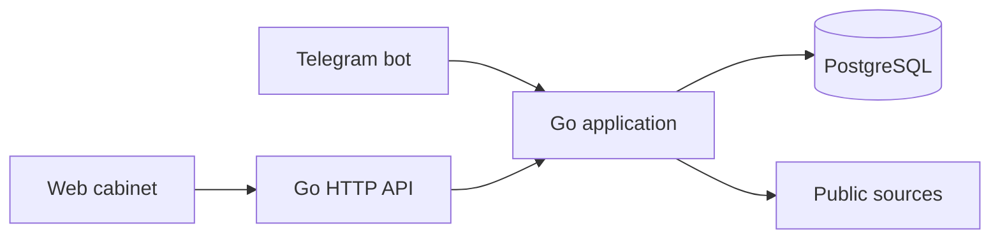

# CareerRadar

[Русская версия](README.md)

A work-in-progress personal IT opportunity tracker built with Go and PostgreSQL. CareerRadar collects public job information without LLMs and keeps unknown facts separate from confirmed ones.

> **Development preview:** the product does not yet meet the complete MVP specification. Review the limitations below before relying on it for real applications.

## Current functionality

- Add, confirm, disable, edit and remove monitored source URLs through the API; import `name,url` CSV files or the `company,start_url` columns of the `SOURCES` sheet without activating imported sources.
- Search Wikidata for candidate company websites and propose career links for confirmation. Search public Remotive listings with attribution.
- Read schema.org `JobPosting` JSON-LD, follow a bounded number of relevant same-host HTML links and pagination links, and use the public Greenhouse API for Greenhouse boards and job pages.
- Preserve observed facts when a later observation is incomplete; retain source evidence and change snapshots, and distinguish source errors from confirmed closure.
- Schedule enabled-source checks at 08:00 Europe/Moscow with up to two checks concurrently. Missed runs are not backfilled.
- View jobs, source health and check history in a Russian web interface; change application status and preferences. The current collector extracts only some fields used by filters.
- Link a private Telegram chat with an expiring one-use code. The bot supports `/jobs`, `/sources`, `/add`, `/confirm`, `/disable`, `/edit`, `/delete`, `/check`, `/status` and `/help`. New or changed jobs, changed source warnings and daily summaries are queued in PostgreSQL. Uncertain delivery is not retried automatically.
- Serve an authenticated REST API, OpenAPI document and Swagger UI.

## Stack and architecture

Go 1.27, PostgreSQL, `pgx`, `golang.org/x/net/html`, and a small HTML/CSS/JavaScript interface. One process serves HTTP, runs the scheduler and optionally polls Telegram; all interfaces share PostgreSQL.



## Local setup on macOS

Install Go 1.27+ and PostgreSQL, start PostgreSQL, and create a database. For example, with Homebrew:

```sh
brew install go postgresql@18
brew services start postgresql@18
createdb careerradar
```

Set environment variables in your shell. Use a strong unique password; do not commit credentials.

```sh
export DATABASE_URL='postgres://localhost:5432/careerradar?sslmode=disable'
export APP_USER='owner'
export APP_PASSWORD='replace-with-a-strong-password'
go run ./cmd/careerradar
```

The app creates its initial schema on startup and listens only on `127.0.0.1:8080`. Open [the local cabinet](http://127.0.0.1:8080/) and authenticate using `APP_USER` and `APP_PASSWORD`. HTTP Basic credentials must only travel over a trusted local connection or HTTPS; exposing the app requires a separately configured trusted HTTPS proxy.

### Telegram

Create a bot using Telegram's BotFather and provide its token through `TELEGRAM_BOT_TOKEN` before starting the app. In the cabinet, choose **Привязать Telegram**, then send the displayed `/start` command to your bot in a private chat within ten minutes. The code is stored only as a hash and can be used once. A new code cannot replace an already linked account.

Live Telegram delivery has not yet been verified in this environment; the token is not included in the repository.

## API

OpenAPI JSON is at `/openapi.json`, and Swagger UI is at `/swagger`. Swagger UI loads its assets from a public CDN. All endpoints require HTTP Basic authentication.

```sh
curl -u "$APP_USER:$APP_PASSWORD" http://127.0.0.1:8080/api/sources
curl -u "$APP_USER:$APP_PASSWORD" -H 'Content-Type: application/json' \
  -d '{"name":"Example","url":"https://example.com/careers"}' \
  http://127.0.0.1:8080/api/sources
```

A newly added source is disabled. Confirm it with `PUT /api/sources/{id}` before calling `POST /api/sources/{id}/check`. Import a CSV with `name,url` columns, or a `SOURCES` export with `company,start_url` columns using `POST /api/sources/import` and `Content-Type: text/csv`. The original Google spreadsheet can be read via the connected Google Drive tool. Export its `SOURCES` sheet to CSV for import; the application does not modify it.

## Tests

```sh
go test ./...
go vet ./...
go build ./...
```

PostgreSQL tests are skipped without `TEST_DATABASE_URL`. Provide a **dedicated disposable test database**, then run:

```sh
createdb careerradar_test
export TEST_DATABASE_URL='postgres://localhost:5432/careerradar_test?sslmode=disable'
go test -race -count=1 ./...
```

Optional live smoke tests require network access and are excluded by default:

```sh
SMOKE_COMPANY=Cloudflare go test ./internal/discovery -run TestPublicCompanySmoke -v
SMOKE_SOURCE_URL='https://boards.greenhouse.io/COMPANY/jobs/JOB_ID' go test ./internal/collector -run TestPublicSourceSmoke -v
```

## Known limitations

- This is not a complete implementation of the original specification. Generic websites that do not expose supported JSON-LD may require attention; JavaScript rendering, CAPTCHA, authentication and access restrictions are not bypassed.
- The crawler is bounded by time, depth, page count and response size. Greenhouse listings may lack full job details. A failed or incomplete check does not close or delete jobs.
- Remotive results are delayed by the provider, are limited to remote jobs and may not be suitable for the user's geography. Search results are saved in the catalog with Remotive attribution; company sources are not enabled automatically.
- Company discovery depends on Wikidata and homepage links and can return ambiguous candidates. Always verify a candidate before enabling it.
- Only a subset of attributes is extracted and applied to catalog filtering. Level, languages, workload, compensation, program type and other fields are not yet extracted from all sources. Recognized languages from JSON-LD skills are retained, and a preference matches any of them. Exact weekly hours and exact monthly salaries are read only when explicitly structured in supported JSON-LD. Geographic matching is exact.
- Deduplication removes URL fragments and UTM parameters but does not merge distinct canonical URLs. Owners can record and undo a confirmed closure with an evidence link; automated confirmation of closures is not implemented.
- The interface does not yet include every requested management action; the catalog was visually inspected at desktop and 390 px widths; other mobile workflows have not been fully verified.
- The delivery queue does not automatically retry a send with an uncertain result; a notification interrupted during sending requires investigation. The History section lets the owner mark a message received or explicitly request a retry after considering the duplicate risk. Account linking, status changes and source management commit together with the update acknowledgement. Manual checks are durably queued and can run again after a crash; owner replies are stored in the notification outbox.
- The automated checks do not replace a real Telegram end-to-end test, a clean-machine deployment test, or resolution of the outstanding findings in [the independent audit](docs/review.md).
