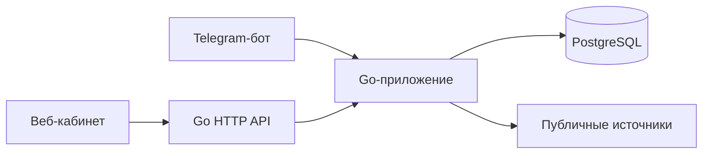

# CareerRadar

[English version](README.en.md)

[План разработки (English)](docs/superpowers/plan.md)

Персональный агрегатор IT-вакансий и стажировок на Go и PostgreSQL. CareerRadar собирает общедоступные данные без LLM и сохраняет отсутствующие сведения как неизвестные.

> **Проект в разработке:** приложение ещё не полностью соответствует спецификации MVP. Перед использованием ознакомьтесь с ограничениями ниже.

## Возможности

- Добавление, подтверждение, отключение, редактирование и удаление источников через API. Импорт CSV с колонками `name,url` или `company,start_url` из листа `SOURCES`; импортированные источники остаются выключенными до подтверждения.
- Поиск сайтов компаний через Wikidata и предложение карьерных страниц для подтверждения, включая явно указанные доски Greenhouse, Lever и Ashby и подписанные ссылки на карьерные домены с совпадающим именем компании. Поиск публичных IT-вакансий в RSS-выдаче Хабр Карьеры с указанием источника.
- Чтение schema.org [`JobPosting`](https://schema.org/JobPosting) и [`EducationalOccupationalProgram`](https://schema.org/EducationalOccupationalProgram) в JSON-LD и Microdata, включая относительные ссылки; ограниченный обход ссылок и страниц пагинации на том же сайте, работа с публичными API Greenhouse и Ashby и [публичным XML feed Lever](https://hire.lever.co/developer/usecases). Если на странице опубликованы оба формата, используется JSON-LD, чтобы не создавать повторные наблюдения. Для индивидуальной HTML-страницы без структурированных данных сохраняются заголовок и ссылка на отклик, если URL похож на вакансию и кнопка `Apply` опубликована явно; остальные отсутствующие поля требуют уточнения. Greenhouse location, дедлайн, заголовок и описание берутся из его API. Ashby предоставляет места работы, заявку и объявленную оплату; Lever feed — компанию, локацию, занятость, описание и ссылку отклика. Неопубликованные или неоднозначные сведения требуют уточнения.
- Сохранение ранее полученных данных при неполных последующих проверках, ссылок на источники и истории изменений. В карточке доступны предыдущие значения условий, дедлайнов и описание. Ошибка источника не считается подтверждением закрытия вакансии. Для ранее сохранённой индивидуальной вакансии Greenhouse используется `404` её точного публичного Job Board API endpoint; для Lever — только `404` точной страницы отдельной вакансии после отсутствия в публичном feed. Перенаправление, отказ доступа или одно лишь отсутствие в feed закрытием не считаются. Если соответствующий Greenhouse endpoint или Lever feed снова публикует закрытую этим источником вакансию, она автоматически открывается; ручные отметки владельца сохраняются. Jobicy использует свой статусный API.
- Проверка включённых источников ежедневно в 08:00 по московскому времени, не более двух одновременно. Пропущенные проверки не запускаются задним числом.
- Русскоязычный веб-кабинет с поиском по названию и компании и комбинируемыми фильтрами каталога по уровню, направлению, языку, компании, географии, типу предложения и формату работы; для каждого фильтра можно указать несколько значений. Также доступны состояние источников, история проверок, статусы отклика и изменяемые предпочтения, включая минимальную и максимальную месячную оплату. Начальные предпочтения включают Go/Python, заданные IT-направления, Россию/Казань/Иннополис и максимум 30 часов в неделю. Поддерживаемые API и JSON-LD источников дают дополнительные факты, однако извлечение остаётся частичным.
- Привязка личного чата Telegram одноразовым кодом с ограниченным сроком действия. Бот поддерживает команды `/jobs`, `/sources`, `/cabinet`, `/add`, `/confirm`, `/disable`, `/edit`, `/delete`, `/check`, `/status` и `/help`. `/cabinet` ведёт к разделам кабинета, а `/jobs` — к карточкам, если настроен публичный HTTPS `CABINET_URL`. Список `/jobs` показывает статусы отклика и отметки закрытия и уточнения; уведомления о новых и изменённых вакансиях содержат известные условия и изменения, включая дедлайн и оплату. Ежедневная сводка включает количество новых и изменённых вакансий за последние 24 часа. Сводки и ошибки источников сохраняются в очереди PostgreSQL. Отправка с неизвестным результатом автоматически не повторяется.
- REST API с аутентификацией, описание OpenAPI и Swagger UI.

Категории предложений: `Job`, `Internship`, `Trainee / Graduate Program` и `Education / Bootcamp`. Категория вакансии берётся из структурированного типа объявления; стажировки и программы также распознаются по однозначным русским или английским словам в названии. Если название смешивает категории, тип остаётся неизвестным. Уровень Intern/Junior/Middle/Senior распознаётся по явным английским и распространённым русским вариантам; при конфликте уровень остаётся неизвестным. Опубликованные `qualifications`, `educationRequirements`, `experienceRequirements` и `programPrerequisites` сохраняются в описании вакансии или программы.

## Технологии и архитектура

Go 1.27, PostgreSQL, `pgx`, `golang.org/x/net/html` и небольшой интерфейс на HTML, CSS и JavaScript. Один процесс обслуживает HTTP-запросы, запускает планировщик и при настройке получает сообщения Telegram; все интерфейсы используют общую PostgreSQL.



## Локальный запуск на macOS

Установите Go 1.27+ и PostgreSQL, запустите PostgreSQL и создайте базу данных. Например, с помощью Homebrew:

```sh
brew install go postgresql@18
brew services start postgresql@18
createdb careerradar
```

Задайте переменные окружения в терминале. Используйте надёжный уникальный пароль и не добавляйте учётные данные в репозиторий.

```sh
export DATABASE_URL='postgres://localhost:5432/careerradar?sslmode=disable'
export APP_USER='owner'
export APP_PASSWORD='replace-with-a-strong-password'
go run ./cmd/careerradar
```

При запуске приложение создаёт начальную схему базы и по умолчанию слушает `127.0.0.1:8080`. Если порт занят, задайте `HTTP_ADDR`, например `127.0.0.1:18080`, и используйте этот адрес в браузере и API-запросах. Откройте [личный кабинет](http://127.0.0.1:8080/) и войдите с помощью `APP_USER` и `APP_PASSWORD`. Учётные данные HTTP Basic следует передавать только через доверенное локальное соединение или HTTPS; для внешнего доступа необходимо отдельно настроить доверенный HTTPS-прокси.

### Telegram

Создайте бота через BotFather и перед запуском приложения задайте его токен в переменной `TELEGRAM_BOT_TOKEN`. В кабинете нажмите **«Привязать Telegram»** и в течение десяти минут отправьте показанную команду `/start` своему боту в личном чате. Код хранится только в виде хеша и используется один раз. Новый код не может заменить уже привязанный аккаунт.

Если кабинет доступен с телефона через настроенный вами HTTPS-прокси, задайте `CABINET_URL=https://your-host/`. Команда `/cabinet` покажет ссылки на разделы, а `/jobs` — ссылки на карточки. Приложение не настраивает прокси автоматически; без этой переменной ссылки кабинета в боте отключены.

В этой среде проверены привязка, команды `/help`, `/sources`, `/jobs` и доставка одного уведомления о вакансии; получение подтвердил владелец. Остальные команды на реальном боте не проверены. Токена бота в репозитории нет.

## API

Описание OpenAPI доступно по адресу `/openapi.json`, Swagger UI — по адресу `/swagger`. Swagger UI загружает ресурсы из публичной CDN. Для всех конечных точек нужна аутентификация HTTP Basic.

```sh
curl -u "$APP_USER:$APP_PASSWORD" http://127.0.0.1:8080/api/sources
curl -G -u "$APP_USER:$APP_PASSWORD" --data-urlencode 'q=backend' \
  --data-urlencode 'level=Intern' --data-urlencode 'level=Junior' \
  --data-urlencode 'language=Go' http://127.0.0.1:8080/api/jobs
curl -u "$APP_USER:$APP_PASSWORD" -H 'Content-Type: application/json' \
  -d '{"name":"Example","url":"https://example.com/careers"}' \
  http://127.0.0.1:8080/api/sources
```

`GET /api/jobs` возвращает 50 записей по умолчанию. Параметр `limit` принимает значения 1–100; для следующей страницы передайте значение заголовка `X-Next-Cursor` как `cursor`. Заголовок `X-Has-More: true` означает, что остались записи после SQL-фильтрации. За запрос обрабатывается до 5 000 записей и проверяется наличие ещё одной; она может не соответствовать предпочтениям, поэтому следующая страница иногда пуста, а кабинет позволяет продолжить просмотр.

Новый источник выключен. Подтвердите его запросом `PUT /api/sources/{id}` перед вызовом `POST /api/sources/{id}/check`. Для импорта отправьте CSV с колонками `name,url` или экспорт листа `SOURCES` с колонками `company,start_url` на `POST /api/sources/import` с заголовком `Content-Type: text/csv`. Для импорта вашей Google-таблицы скачайте нужный лист в CSV и загрузите его через кабинет или API; Google OAuth не требуется, исходная таблица не изменяется.

## Тесты

```sh
go test ./...
go vet ./...
go build ./...
```

Без `TEST_DATABASE_URL` тесты PostgreSQL пропускаются. Создайте **отдельную тестовую базу, данные которой можно удалить**, затем выполните:

```sh
createdb careerradar_test
export TEST_DATABASE_URL='postgres://localhost:5432/careerradar_test?sslmode=disable'
go test -race -count=1 ./...
```

Дополнительные проверки реальных источников требуют доступа к сети и по умолчанию не запускаются:

```sh
SMOKE_COMPANY=Cloudflare go test ./internal/discovery -run TestPublicCompanySmoke -v
SMOKE_SOURCE_URL='https://boards.greenhouse.io/COMPANY/jobs/JOB_ID' go test ./internal/collector -run TestPublicSourceSmoke -v
SMOKE_SOURCE_URL='https://jobs.lever.co/xmlexample' go test ./internal/collector -run TestPublicSourceSmoke -v
```

## Известные ограничения

- Исходная спецификация ещё не реализована полностью. Для сайтов без поддерживаемого API, JSON-LD или Microdata сохраняется только уверенно извлечённый заголовок индивидуальной HTML-страницы с явной ссылкой отклика; неизвестные компания, требования, уровень, направление, нагрузка, оплата или дедлайн остаются пустыми и требуют внимания. Поддерживаются вложенная Microdata и свойства, вынесенные через `itemref`; неоднозначные повторяющиеся HTML ID игнорируются. Обход `itemref` ограничен 100 тысячами DOM-узлов на страницу; при превышении уже найденные вакансии сохраняются, а источник помечается для проверки. Приложение не обходит CAPTCHA, авторизацию и ограничения доступа и не выполняет JavaScript-рендеринг страниц.
- Обход ограничен по времени, глубине, числу страниц и размеру ответа. Для списков Greenhouse запрашиваются описания; если ответ слишком большой, сохраняется ограниченный список без описаний и источник помечается для проверки. Ashby поддерживается для адресов досок `https://jobs.ashbyhq.com/BOARD`: ответ больше 8 МиБ помечается ошибкой. Lever поддерживается для `https://jobs.lever.co/BOARD`; его публичный XML feed не содержит дедлайнов и заявленной зарплаты в используемом формате. Другие сведения могут отсутствовать. Неудачная или неполная проверка не закрывает и не удаляет вакансии.
- Глобальный поиск использует [публичную RSS-выдачу Хабр Карьеры](https://career.habr.com/vacancies/rss) и не зависит от добавленных сайтов. Возвращается до 20 уникальных вакансий, совпадающих по названию или тексту описания без учёта регистра и повторных пробелов; пустой результат допустим. Это поиск подстроки, не семантический поиск. Сохраняются компания из поля RSS author, описание и первичная ссылка. Удалёнка отмечается только по явному маркеру ленты; Для первых 20 совпадений приложение дополнительно открывает карточки с ограничением по времени и конкурентности; опубликованные структурированные город, оплата и дедлайн сохраняются. При недоступности карточки сохраняется краткая запись RSS и предупреждение, а ранее подтверждённые данные не затираются. Нагрузка остаётся неизвестной, если не опубликована структурированно. Тип и уровень распознаются по явным словам в названии. Новые источники компаний автоматически не включаются. Remotive удалён по решению владельца.
- Для индивидуальной карточки Хабр Карьеры используется её JobPosting JSON-LD: считываются заголовок, компания, описание, дедлайн, уровень, удалёнка, город и опубликованная месячная оплата. Город-строка и обозначение рубля RUR нормализуются только для этого шаблона. Проверка отдельной вакансии не обходит блок похожих вакансий. Несколько неоднозначных локаций требуют уточнения; известные варианты сохраняются в описании и истории. Неуказанные часы работы не выводятся из FULL_TIME.
- Поиск компаний зависит от Wikidata и ссылок на главной странице; запросы с кириллицей используют русский язык поиска, остальные — английский; перенаправление главной страницы на другой домен или с HTTPS на HTTP требует внимания; возможны неоднозначные результаты. Проверяйте кандидата перед включением источника. Образовательные программы распознаются, только когда источник явно публикует schema.org `EducationalOccupationalProgram`; отдельного каталога учебных заведений нет.
- Простые HTML-фрагменты структурированных описаний и требований преобразуются в текст; неоднозначная разметка сохраняется как опубликована, чтобы не потерять технические записи. Повторная проверка ранее сохранённого HTML может создать одно уведомление об изменении.
- В фильтрах каталога выбранные значения сопоставляются с явно сохранёнными фактами; вакансии с неизвестным значением исключаются, пока соответствующий фильтр включён. Извлекаются и применяются к фильтрации только некоторые атрибуты. Уровень, языки, нагрузка, оплата, тип программы и другие поля извлекаются не из всех источников. Для JSON-LD и Microdata сохраняются распознанные языки из списка навыков, включая перечисление через запятую; выбор одного из них соответствует фильтру. Уровень и тип программы могут быть извлечены из явно указанного слова в названии; неоднозначный уровень остаётся неизвестным. При изменении названия неподтверждённый уровень становится неизвестным, а прежнее значение остаётся в истории; явно опубликованная стажировка сохраняет уровень Intern. Точное число часов в неделю, месячная и годовая оплата считываются из поддерживаемых структурированных данных JSON-LD и Microdata. Годовая оплата нормализуется в месячный эквивалент; месячные и годовые компоненты зарплаты Ashby нормализуются в месячную сумму только при одном явно указанном компоненте Salary. Дробная месячная сумма после деления годовой оплаты сохраняется как диапазон с округлением границ наружу до целых денежных единиц, чтобы не давать ложного соответствия лимиту. Диапазон оплаты, пересекающий любой настроенный предел, остаётся для уточнения; при обновлении только одной границы прежний диапазон сохраняется в истории. География сопоставляется по точному названию с учётом нескольких русских и английских вариантов России, Казани и Иннополиса. Если указана только Россия, удалённая вакансия может соответствовать фильтру, а для офисной или гибридной вакансии без города нужна уточняющая проверка.
- Дедупликация удаляет фрагменты URL и параметры UTM; для поддерживаемых адресов Jobicy используется также ID вакансии. Разные страницы связываются с одной карточкой, если URL или явная ссылка отклика содержит идентификатор отдельной вакансии Greenhouse, Lever или Ashby. Связь адресов сохраняется в PostgreSQL: неполная повторная проверка сохраняет карточку, статус отклика и ссылки на источники. Общие формы отклика и похожие названия не используются для объединения. Конфликт с уже существующими карточками требует внимания; записи и история сохраняются. Если несколько ранее сохранённых записей Jobicy имеют один ID, источник требует внимания и записи не объединяются автоматически. Владелец может подтвердить закрытие и отменить отметку. Автоматическое закрытие Jobicy основано на статусном API для того же ID (`closed`); `unknown` и ошибки оставляют вакансию без изменений. Для ранее сохранённой индивидуальной вакансии Greenhouse сигналом закрытия служит `404` от точного API endpoint этой вакансии. Для Lever используется `404` точной публичной страницы вакансии, только если её ID отсутствует в feed; отсутствие в feed само по себе не закрывает вакансию. Проверка списка вакансий Greenhouse не закрывает отсутствующие карточки. Jobicy — статус публикации, не прямое подтверждение работодателя. Включённые отдельные страницы Jobicy проверяются пакетами до 100 ID; результаты, включая ошибки страниц, сохраняются на час. Новый источник после начала прохода и временная ошибка страницы могут потребовать повторной проверки после часового ограничения. Для индивидуальной страницы Хабр Карьеры закрытие подтверждается явной DOM-отметкой «Вакансия в архиве» на точном адресе без перенаправления при HTTP 200 или 410; другие ошибки и отсутствие в выдаче не считаются закрытием. При повторной публикации на той же странице отменяется только автоматическое закрытие Хабра. Глобальный поиск тоже применяет подтверждённую отметку к ранее сохранённой вакансии; неизвестные архивные вакансии не создаются. Частичная проверка не переоткрывает карточку, а ручное закрытие владельца сохраняется. Для остальных источников автоматические сигналы закрытия не реализованы.
- Интерфейс каталога и его адаптивная раскладка проверялись на десктопной и мобильной ширине 390 px; другие мобильные сценарии и удобство на реальном телефоне не проверены.
- При неизвестном результате отправки очередь не повторяет её автоматически; прерванное уведомление требует выяснения. В разделе «История» можно отметить сообщение полученным или явно запросить повтор с учётом риска дублирования. Привязка, изменение статуса и управление источниками подтверждаются в одной транзакции с изменением данных. Ручная проверка ставится в устойчивую очередь и после сбоя может быть выполнена повторно; ответы владельцу сохраняются в очереди уведомлений.
- Полная проверка всех команд реального Telegram-бота, развёртывание на чистой машине и устранение оставшихся замечаний [независимого аудита](docs/review.md) ещё не завершены.
