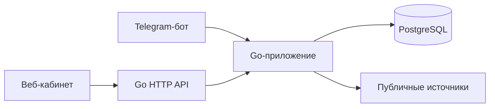

# CareerRadar

[English version](README.en.md)

Персональный агрегатор IT-вакансий и стажировок на Go и PostgreSQL. CareerRadar собирает общедоступные данные без LLM и сохраняет отсутствующие сведения как неизвестные.

> **Проект в разработке:** приложение ещё не полностью соответствует спецификации MVP. Перед использованием ознакомьтесь с ограничениями ниже.

## Возможности

- Добавление, подтверждение, отключение, редактирование и удаление источников через API. Импорт CSV с колонками `name,url` или `company,start_url` из листа `SOURCES`; импортированные источники остаются выключенными до подтверждения.
- Поиск сайтов компаний через Wikidata и предложение карьерных страниц для подтверждения. Поиск публичных вакансий Remotive с указанием источника.
- Чтение JSON-LD `JobPosting` по schema.org, ограниченный обход ссылок и страниц пагинации на том же сайте, работа с публичным API Greenhouse.
- Сохранение ранее полученных данных при неполных последующих проверках, ссылок на источники и истории изменений. Ошибка источника не считается подтверждением закрытия вакансии.
- Проверка включённых источников ежедневно в 08:00 по московскому времени, не более двух одновременно. Пропущенные проверки не запускаются задним числом.
- Русскоязычный веб-кабинет с вакансиями, состоянием источников и историей проверок; изменение статусов отклика и предпочтений. Сборщик пока извлекает лишь часть полей, используемых фильтрами.
- Привязка личного чата Telegram одноразовым кодом с ограниченным сроком действия. Бот поддерживает команды `/jobs`, `/sources`, `/add`, `/confirm`, `/disable`, `/edit`, `/delete`, `/check`, `/status` и `/help`. Уведомления о новых и изменённых вакансиях, новых ошибках источников и ежедневные сводки сохраняются в очереди PostgreSQL. Отправка с неизвестным результатом автоматически не повторяется.
- REST API с аутентификацией, описание OpenAPI и Swagger UI.

## Технологии и архитектура

Go 1.27, PostgreSQL, `pgx`, `golang.org/x/net/html` и небольшой интерфейс на HTML, CSS и JavaScript. Один процесс обслуживает HTTP-запросы, запускает планировщик и при настройке получает сообщения Telegram; все интерфейсы используют общую PostgreSQL.



## Локальный запуск на macOS

Установите Go 1.27+ и PostgreSQL, запустите PostgreSQL и создайте базу данных. Например, с помощью Homebrew:

```sh
brew install go postgresql@18
brew services start postgresql@18
createdb careerradar
```

Задайте переменные окружения в терминале. Используйте надёжный уникальный пароль и не добавляйте учётные данные в репозиторий.

```sh
export DATABASE_URL='postgres://localhost:5432/careerradar?sslmode=disable'
export APP_USER='owner'
export APP_PASSWORD='replace-with-a-strong-password'
go run ./cmd/careerradar
```

При запуске приложение создаёт начальную схему базы и слушает только `127.0.0.1:8080`. Откройте [личный кабинет](http://127.0.0.1:8080/) и войдите с помощью `APP_USER` и `APP_PASSWORD`. Учётные данные HTTP Basic следует передавать только через доверенное локальное соединение или HTTPS; для внешнего доступа необходимо отдельно настроить доверенный HTTPS-прокси.

### Telegram

Создайте бота через BotFather и перед запуском приложения задайте его токен в переменной `TELEGRAM_BOT_TOKEN`. В кабинете нажмите **«Привязать Telegram»** и в течение десяти минут отправьте показанную команду `/start` своему боту в личном чате. Код хранится только в виде хеша и используется один раз. Новый код не может заменить уже привязанный аккаунт.

Реальная доставка сообщений Telegram в этой среде пока не проверена; токена бота в репозитории нет.

## API

Описание OpenAPI доступно по адресу `/openapi.json`, Swagger UI — по адресу `/swagger`. Swagger UI загружает ресурсы из публичной CDN. Для всех конечных точек нужна аутентификация HTTP Basic.

```sh
curl -u "$APP_USER:$APP_PASSWORD" http://127.0.0.1:8080/api/sources
curl -u "$APP_USER:$APP_PASSWORD" -H 'Content-Type: application/json' \
  -d '{"name":"Example","url":"https://example.com/careers"}' \
  http://127.0.0.1:8080/api/sources
```

Новый источник выключен. Подтвердите его запросом `PUT /api/sources/{id}` перед вызовом `POST /api/sources/{id}/check`. Для импорта отправьте CSV с колонками `name,url` или экспорт листа `SOURCES` с колонками `company,start_url` на `POST /api/sources/import` с заголовком `Content-Type: text/csv`. Исходную Google-таблицу можно прочитать через подключённый инструмент Google Drive; экспортируйте лист `SOURCES` в CSV для импорта. Приложение не изменяет таблицу.

## Тесты

```sh
go test ./...
go vet ./...
go build ./...
```

Без `TEST_DATABASE_URL` тесты PostgreSQL пропускаются. Создайте **отдельную тестовую базу, данные которой можно удалить**, затем выполните:

```sh
createdb careerradar_test
export TEST_DATABASE_URL='postgres://localhost:5432/careerradar_test?sslmode=disable'
go test -race -count=1 ./...
```

Дополнительные проверки реальных источников требуют доступа к сети и по умолчанию не запускаются:

```sh
SMOKE_COMPANY=Cloudflare go test ./internal/discovery -run TestPublicCompanySmoke -v
SMOKE_SOURCE_URL='https://boards.greenhouse.io/COMPANY/jobs/JOB_ID' go test ./internal/collector -run TestPublicSourceSmoke -v
```

## Известные ограничения

- Исходная спецификация ещё не реализована полностью. Для сайтов без поддерживаемого JSON-LD может потребоваться дополнительная обработка; приложение не обходит CAPTCHA, авторизацию и ограничения доступа и не выполняет JavaScript-рендеринг страниц.
- Обход ограничен по времени, глубине, числу страниц и размеру ответа. Списки Greenhouse могут не содержать полных сведений о вакансиях. Неудачная или неполная проверка не закрывает и не удаляет вакансии.
- Remotive публикует результаты с задержкой; источник ограничен удалёнными вакансиями, которые могут не подходить по географии. Результаты сохраняются в каталоге со ссылкой на Remotive; источник компании автоматически не включается.
- Поиск компаний зависит от Wikidata и ссылок на главной странице; возможны неоднозначные результаты. Проверяйте кандидата перед включением источника.
- Извлекаются и применяются к фильтрации только некоторые атрибуты. Уровень, языки, нагрузка, оплата, тип программы и другие поля извлекаются не из всех источников. Для JSON-LD сохраняются распознанные языки из списка навыков; выбор одного из них соответствует фильтру. Точное число часов в неделю и точная месячная оплата считываются только из поддерживаемых структурированных данных JSON-LD. География сопоставляется точным сравнением.
- Дедупликация удаляет фрагменты URL и параметры UTM; для поддерживаемых адресов Jobicy используется также ID вакансии. Разные адреса других сайтов не объединяются. Если несколько ранее сохранённых записей Jobicy имеют один ID, источник требует внимания и записи не объединяются автоматически. Владелец может подтвердить закрытие и отменить отметку. Автоматическое закрытие и повторное открытие поддерживаются для ранее сохранённых вакансий Jobicy по статусам `closed` и `active` публичного API для того же ID. Ручное закрытие и старые закрытия без известного происхождения автоматически не отменяются. Это статус записи Jobicy, а не прямое подтверждение работодателя; `unknown` и ошибки оставляют вакансию без изменений. Включённые отдельные страницы Jobicy проверяются пакетами до 100 ID; результаты, включая ошибки страниц, сохраняются на час. Новый источник после начала прохода и временная ошибка страницы могут потребовать повторной проверки после часового ограничения. Автоматическая проверка закрытия для других сайтов пока не реализована.
- Интерфейс пока не содержит всех запрошенных действий. Каталог визуально проверен на десктопной и мобильной ширине 390 px; остальные мобильные сценарии полностью не проверены.
- При неизвестном результате отправки очередь не повторяет её автоматически; прерванное уведомление требует выяснения. В разделе «История» можно отметить сообщение полученным или явно запросить повтор с учётом риска дублирования. Привязка, изменение статуса и управление источниками подтверждаются в одной транзакции с изменением данных. Ручная проверка ставится в устойчивую очередь и после сбоя может быть выполнена повторно; ответы владельцу сохраняются в очереди уведомлений.
- Автоматические проверки не заменяют сквозной тест с реальным Telegram-ботом, проверку развёртывания на чистой машине и устранение замечаний [независимого аудита](docs/review.md).
